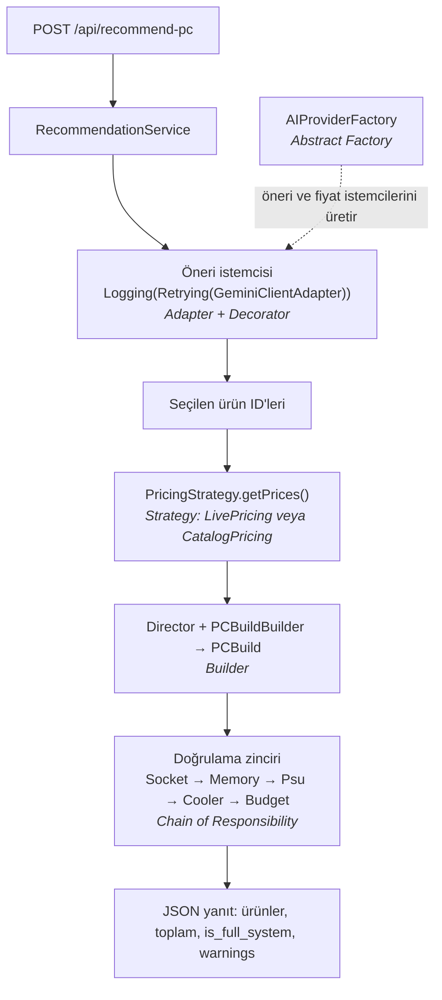
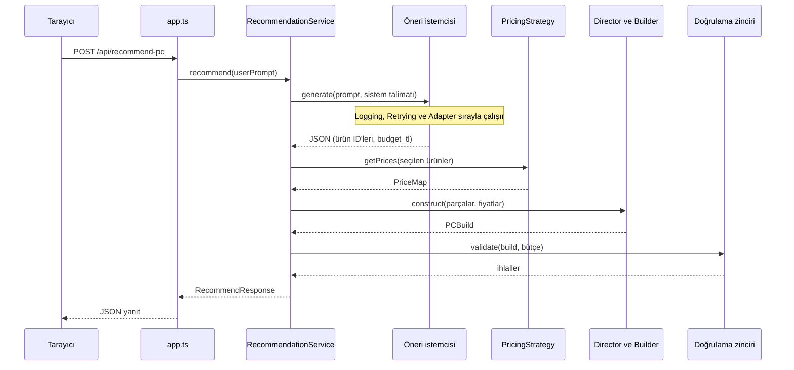
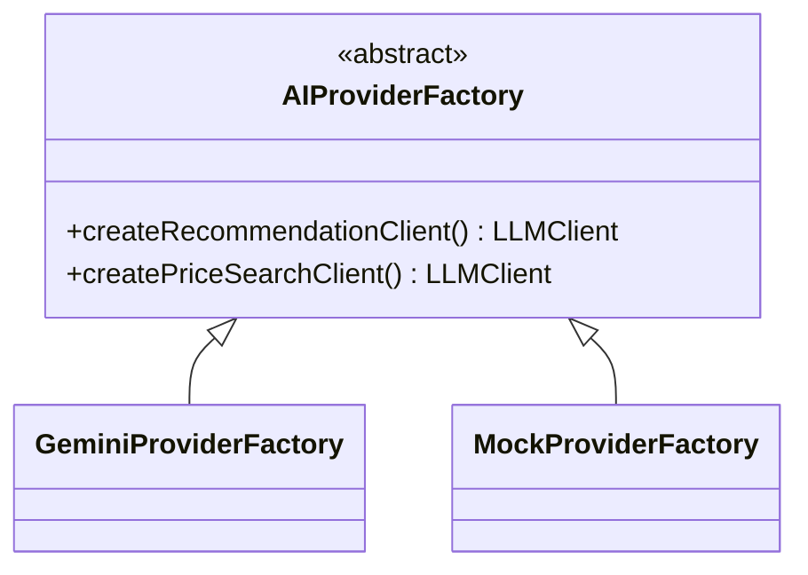
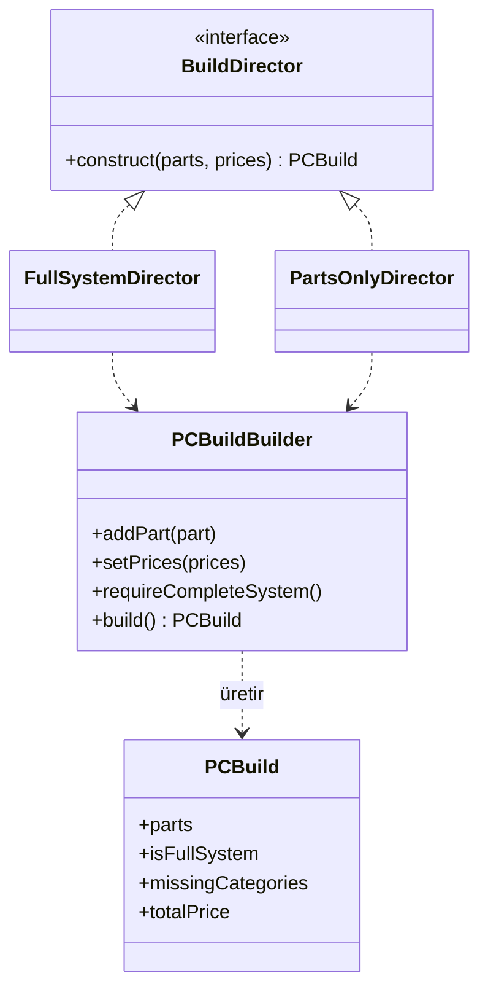
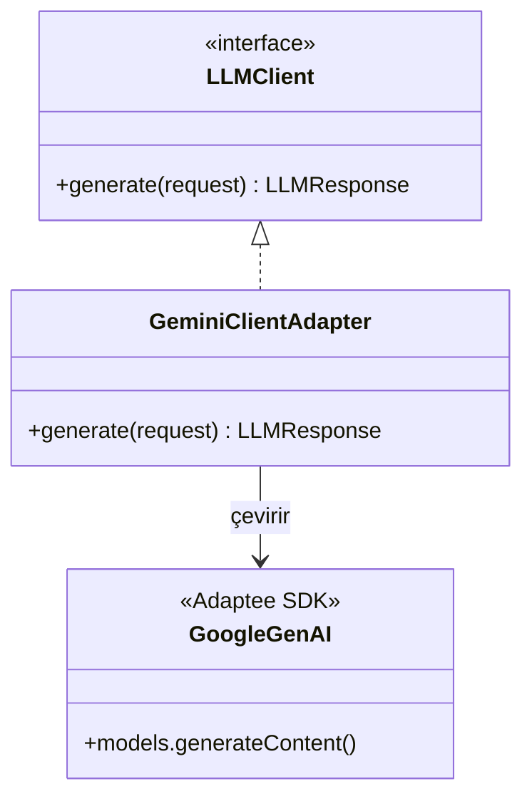
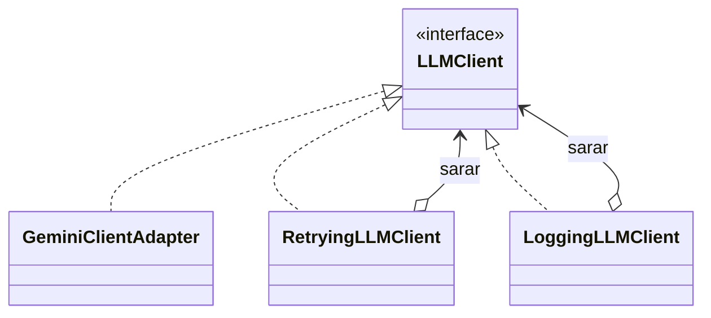
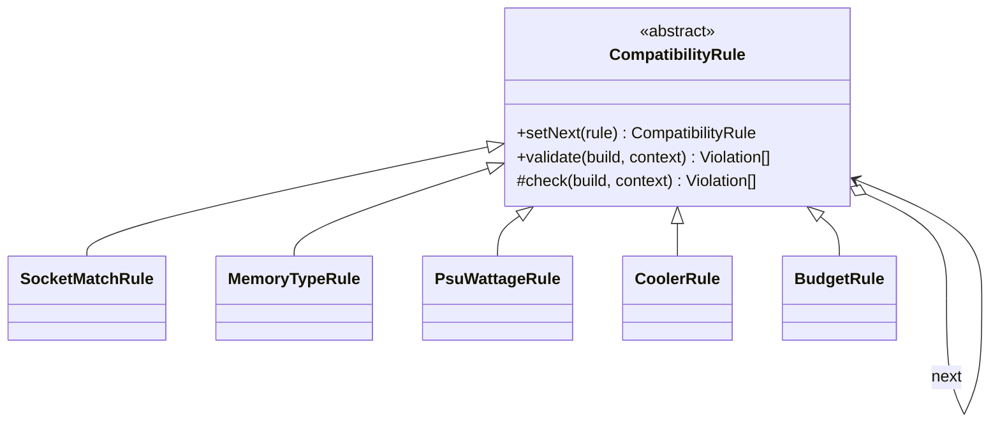
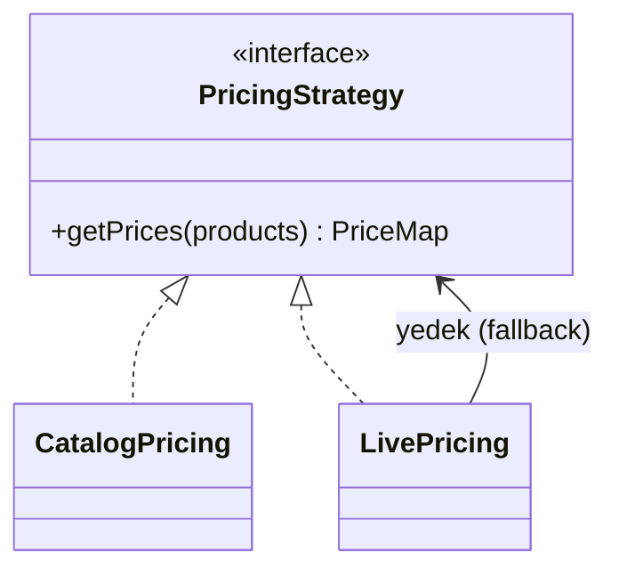

# Tasarım Kalıpları

AI-PC Builder'da altı GoF kalıbı kullanılmıştır (her gruptan iki tane). Bu belge her kalıbın **hangi problemi çözdüğünü**, **hangi sınıflarla uygulandığını** ve **nasıl test edildiğini** gösterir. Kodda her rol, ilgili sınıfın başında `[Kalıp: ...]` yorumuyla işaretlidir.

## Çözülen problemler

Kalıplar uygulanmadan önce kodun büyük kısmı tek bir 390 satırlık `server.ts` içindeydi ve üç sorun vardı:

| Problem | Çözen kalıplar |
|---|---|
| **Model çıktısı doğrulanmıyordu.** Uyumluluk ve bütçe kontrolü yapay zekâya bırakılmıştı; bir testte 30.000 TL bütçeye 43.249 TL'lik, güç kaynağı olmayan bir sistem önerilmişti. | Chain of Responsibility, Builder |
| **Gemini'ye sıkı bağımlılık.** SDK doğrudan çağrılıyordu; model değiştirmek veya kredi harcamadan test yazmak mümkün değildi. | Adapter, Abstract Factory |
| **Kurallar tek rotaya gömülüydü.** Fiyatlama, yeniden deneme ve loglama yaklaşık 100 satırlık tek bir işleyicideydi. | Decorator, Strategy |

## Özet tablo

| Grup | Kalıp | Ana sınıflar | Test dosyası |
|---|---|---|---|
| Yaratımsal | Abstract Factory | [`AIProviderFactory`](src/ai/AIProviderFactory.ts), [`GeminiProviderFactory`](src/ai/GeminiProviderFactory.ts), [`MockProviderFactory`](src/ai/MockProviderFactory.ts) | [`factory.test.ts`](test/factory.test.ts) |
| Yaratımsal | Builder | [`PCBuildBuilder`](src/builder/PCBuildBuilder.ts), [`FullSystemDirector`, `PartsOnlyDirector`](src/builder/directors.ts), [`PCBuild`](src/builder/PCBuild.ts) | [`builder.test.ts`](test/builder.test.ts) |
| Yapısal | Adapter | [`LLMClient`](src/ai/LLMClient.ts), [`GeminiClientAdapter`](src/ai/GeminiClientAdapter.ts) | [`adapter.test.ts`](test/adapter.test.ts) |
| Yapısal | Decorator | [`RetryingLLMClient`](src/ai/RetryingLLMClient.ts), [`LoggingLLMClient`](src/ai/LoggingLLMClient.ts) | [`decorators.test.ts`](test/decorators.test.ts) |
| Davranışsal | Chain of Responsibility | [`CompatibilityRule`](src/validation/CompatibilityRule.ts), `SocketMatchRule`, `MemoryTypeRule`, `PsuWattageRule`, `CoolerRule`, `BudgetRule` ([`src/validation/`](src/validation)) | [`validation.test.ts`](test/validation.test.ts) |
| Davranışsal | Strategy | [`PricingStrategy`](src/pricing/PricingStrategy.ts), [`CatalogPricing`](src/pricing/CatalogPricing.ts), [`LivePricing`](src/pricing/LivePricing.ts) | [`pricing.test.ts`](test/pricing.test.ts) |

Kalıpları birbirine bağlayan sınıf [`RecommendationService`](src/RecommendationService.ts), bağlama işinin yapıldığı yer ise [`composition.ts`](src/composition.ts).

## Kalıp Haritası

Her kalıp için çözülen problem, katılımcı roller ve onları karşılayan sınıflar, değerlendirilen alternatif tasarım ve seçilen çözümün bedeli. UML sınıf diyagramları aşağıdaki kalıp bölümlerinde, sıralama diyagramı "Bir öneri isteğinin yolu" bölümündedir.

| Kalıp | Çözülen problem | Katılımcı roller ve karşılayan sınıflar | Değerlendirilen alternatif | Seçilen çözümün bedeli |
|---|---|---|---|---|
| **Abstract Factory** | Öneri ve fiyat istemcileri birlikte, aynı sağlayıcıdan gelmeli; gerçek sağlayıcıyı kredi harcamadan değiştirmek gerekiyor | AbstractFactory: `AIProviderFactory` ConcreteFactory: `GeminiProviderFactory`, `MockProviderFactory` AbstractProduct: `LLMClient` ConcreteProduct: `Logging(Retrying(GeminiClientAdapter))`, `MockLLMClient` Client: `composition.ts`, `RecommendationService` | `AI_PROVIDER` değerine göre `if/else` ile doğrudan `new` çağırmak; ya da her istemci için ayrı bir Factory Method | Üç ek sınıf. Tek gerçek sağlayıcı (Gemini) varken fazla görünebilir. Fabrikaya yeni bir ürün tipi (üçüncü istemci) eklemek tüm fabrikaları değiştirir |
| **Builder** | "Tam sistem mi?" bilgisi arayüzde Türkçe kategori adlarıyla hesaplanıyordu; komple ve tek parça istekleri farklı kurulmalı | Builder: `PCBuildBuilder` (soyut Builder arayüzü yok, tek somut builder) Director: `BuildDirector` arayüzü, `FullSystemDirector`, `PartsOnlyDirector` Product: `PCBuild` Client: `RecommendationService` (`selectDirector`) | Hesaplamayı `PCBuild` kurucusuna koymak ya da tek bir `buildSystem()` fonksiyonu yazmak | Küçük bir iş için üç sınıf ve bir arayüz: iki Director arasındaki fark yalnızca "komple sistem kontrolü" adımı. Kalıbın değeri tekrar eden ürünü atması, dahili grafik istisnasını uygulaması ve değişmez bir `PCBuild` üretmesinde; yeni bir istek türü eklenmezse getirisi sınırlı |
| **Adapter** | SDK'nın biçimi (`generateContent`, `groundingMetadata`) tüm koda yayılmıştı | Target: `LLMClient` Adapter: `GeminiClientAdapter` Adaptee: `GoogleGenAI` (SDK) Client: `RecommendationService`, `LivePricing` | SDK'yı doğrudan çağırmak, en fazla bir yardımcı fonksiyonla (Facade) sadeleştirmek | Bir ek katman. Arayüz yalnızca `generate` içerir; SDK'nın akış (stream) gibi özellikleri arayüzde yok, istenirse arayüz genişler. Şimdilik tek bir Adaptee var |
| **Decorator** | Yeniden deneme ve loglama iş mantığının içine gömülüydü | Component: `LLMClient` ConcreteComponent: `GeminiClientAdapter`, `MockLLMClient` ConcreteDecorator: `RetryingLLMClient`, `LoggingLLMClient` (ortak soyut Decorator sınıfı yok, ikisi doğrudan `LLMClient`'ı uygular) Client: `GeminiProviderFactory` zinciri kurar | Kalıtım (`RetryingGeminiClient extends GeminiClientAdapter`): Logging ile Retry kombinasyonları sınıf sayısını patlatır; ya da retry kodunu adaptörün içine gömmek | Zincir sırası önemli (Logging dışta, Retrying içte). Her dekoratör arayüzün tüm metotlarını sarmalamalı (şimdilik tek metot). Çağrı yığını uzar, hata ayıklamak biraz zorlaşır |
| **Chain of Responsibility** | Uyumluluk ve bütçe sunucuda hiç denetlenmiyordu | Handler: `CompatibilityRule` (soyut sınıf) ConcreteHandler: `SocketMatchRule`, `MemoryTypeRule`, `PsuWattageRule`, `CoolerRule`, `BudgetRule` Client: `createValidationChain`, `RecommendationService` | Kural listesi üzerinde döngü (`rules.forEach(...)`) | Bizim zincirde tüm halkalar çalışıp ihlalleri topluyor; klasik CoR'daki "ilk uygun halka işi alıp durur" özelliği kullanılmıyor, bu yüzden davranış bir kural listesi döngüsünden farksız. Kalıp, kuralların bağımsız halkalar olarak eklenip çıkarılabilmesi ve ileride "kritik hatada zinciri kes" gibi bir davranışın eklenebilmesi için seçildi |
| **Strategy** | "Bir ürünün bugünkü fiyatı" tek bir yerde sabitlenmişti | Strategy: `PricingStrategy` ConcreteStrategy: `CatalogPricing`, `LivePricing` Context: `RecommendationService` Client: `composition.ts` stratejiyi seçer | `if (mode === 'live')` dalları ya da bir fonksiyon (lambda) | Bir arayüz ve iki sınıf. `LivePricing` önbellek durumunu tuttuğu için tek örnek yaşatılmalı. Strateji yalnızca sunucu başlarken seçilir, istek başına değil |

## Bir öneri isteğinin yolu

### Sıralama diyagramı

Aynı isteğin nesneler arasındaki mesaj akışı:

## 1. Abstract Factory — sağlayıcı ailesi

**Problem:** Öneri istemcisi ve fiyat arama istemcisi birbirine bağlı iki üründür (ikisi de aynı sağlayıcıdan gelmeli) ve gerçek sağlayıcıyı kredi harcamadan değiştirmek gerekir.

**Çözüm:** `AIProviderFactory` iki ürün üretir: `createRecommendationClient()` ve `createPriceSearchClient()`. `GeminiProviderFactory` Gemini ailesini, `MockProviderFactory` sahte aileyi üretir. Hangisinin kullanılacağı tek yerde, `AI_PROVIDER` ortam değişkeniyle seçilir ([`createProviderFromEnv.ts`](src/ai/createProviderFromEnv.ts)).

**Değişime dayanıklılık:** Yeni bir model sağlayıcısı = yeni bir fabrika + yeni bir adaptör. Mevcut kod değişmez.

## 2. Builder — sistemi adım adım kurmak

**Problem:** "Komple sistem" ve "sadece ekran kartı" istekleri farklı kurulur. "Bu bir tam sistem mi?" sorusunu eskiden arayüz Türkçe kategori adlarını eşleştirerek cevaplıyordu.

**Çözüm:** `PCBuildBuilder` parçaları, fiyatları ve "tam sistem kontrolü" adımını sunar. `FullSystemDirector` hepsini sırayla çağırır, `PartsOnlyDirector` kontrol adımını atlar. Sonuç, değişmez bir `PCBuild` nesnesidir; `isFullSystem` ve `missingCategories` buradan gelir. Dahili grafikli işlemcide (`specs.integrated_graphics`) ekran kartı zorunlu sayılmaz.

## 3. Adapter — SDK'yı sistemden saklamak

**Problem:** Gemini SDK'sı doğrudan çağrıldığı için SDK'nın biçimi (`generateContent`, `groundingMetadata`...) tüm koda yayılmıştı.

**Çözüm:** Uygulama yalnızca `LLMClient` arayüzünü bilir. `GeminiClientAdapter` SDK'nın istek ve yanıt biçimini bu arayüze çevirir; JSON yanıt, Google arama aracı ve düşünme seviyesi gibi SDK ayarları yalnızca burada bilinir.

## 4. Decorator — davranışı iç mantığa dokunmadan eklemek

**Problem:** Yeniden deneme ve loglama iş mantığının içine gömülüydü.

**Çözüm:** `RetryingLLMClient` (503'te bekleyip yeniden dener) ve `LoggingLLMClient` (süre ve sonucu loglar) başka bir `LLMClient`'ı sarar ve aynı arayüzü sunar. İstenen sırayla üst üste takılır: `Logging(Retrying(Adapter))`. Kalıtımla `LoggingRetryingClient` gibi sınıflar türetmek gerekmez.

**Değişime dayanıklılık:** Önbellek istenirse `CachingLLMClient` yeni bir dekoratör olarak eklenir, mevcut sınıflara dokunulmaz.

## 5. Chain of Responsibility — doğrulama zinciri

**Problem:** Uyumluluk ve bütçe kontrolü yapay zekâya bırakılmıştı; sunucu hiçbir şeyi denetlemiyordu.

**Çözüm:** Her kural bir zincir halkasıdır ve yalnızca kendi kuralını denetler, bulduğunu rapora ekleyip isteği bir sonrakine devreder. Zincir [`createValidationChain.ts`](src/validation/createValidationChain.ts) içinde kurulur:

| Halka | Denetlediği kural |
|---|---|
| `SocketMatchRule` | İşlemci soketi = anakart soketi |
| `MemoryTypeRule` | Bellek tipi anakart ve işlemciyle uyumlu |
| `PsuWattageRule` | Güç kaynağı ≥ ekran kartının önerilen gücü |
| `CoolerRule` | Soğutucu işlemcinin gücüne uygun |
| `BudgetRule` | Gerçek fiyatlı toplam ≤ kullanıcının bütçesi |

Kullanıcının bütçesini yapay zekâ `budget_tl` alanıyla bildirir (belirtilmediyse `null`, bu durumda bütçe denetlenmez). Bulunan ihlaller yanıtta `warnings` olarak döner ve arayüzde "⚠️ Dikkat" mesajı olarak gösterilir.

**Değişime dayanıklılık:** Yeni bir kural = yeni bir sınıf + `createValidationChain` içine bir satır. [`validation.test.ts`](test/validation.test.ts) bunu gösteren bir test içerir.

## 6. Strategy — fiyat kaynağı

**Problem:** "Bir ürünün bugünkü fiyatı nedir?" sorusunun cevabı tek bir yerde sabitlenmişti.

**Çözüm:** `PricingStrategy` arayüzünün iki gerçekleştirmesi vardır: `CatalogPricing` (kataloğa yazılı fiyat, ücretsiz) ve `LivePricing` (Google aramasıyla doğrulanmış fiyat; kaynak arama sonucu olmalı, katalog fiyatının en az yarısı olmalı, 24 saat önbellek, bulunamazsa katalog fiyatına düşer). Seçim çalışma zamanında `PRICING_MODE` ortam değişkeniyle yapılır ([`composition.ts`](src/composition.ts)).

**Değişime dayanıklılık:** Kampanya fiyatı gibi yeni bir kaynak = yeni bir strateji sınıfı.

## Sınırlar

- Doğrulama zinciri ihlalleri **uyarı olarak bildirir**; sistemi otomatik düzeltmez veya yapay zekâya geri bildirimle yeniden sordurmaz. Bu, sonraki adım olarak düşünülmüştür.
- Gerçek sağlayıcı yalnızca Gemini'dir; ikinci bir sağlayıcı (ör. başka bir model) eklenmemiştir. Mimari bunu bir fabrika ve bir adaptörle mümkün kılar.
- Bütçe, yapay zekânın `budget_tl` alanına güvenir; model bütçeyi yanlış okursa `BudgetRule` yanlış karşılaştırma yapar. Gerçek Gemini ile yapılan tek denemede bu alanın doğru doldurulup doldurulmadığı ayrıca doğrulanmamıştır.
- **Tasarımın bilinen bir sızıntısı:** Fiyat kaynağı doğrulaması Gemini'ye özgü iki şey içerir: `GROUNDING_REDIRECT_PREFIX` (Google'ın yönlendirme adresi, `src/pricing/priceParsing.ts`) ve fiyat arama metnindeki "Google arama sonucu" ifadesi (`src/pricing/LivePricing.ts`). Başka bir sağlayıcıya (ör. GPT) geçişte yeni fabrika ve adaptöre ek olarak bu doğrulamanın sağlayıcıya taşınması gerekir; yani geçiş tamamen "iki yeni sınıf"tan ibaret olmaz.
- Sağlayıcı (`AI_PROVIDER`) ve fiyat kaynağı (`PRICING_MODE`) sunucu başlarken seçilir; istek başına değiştirilemez ve arayüzde bir seçici yoktur.
- Builder ve Chain of Responsibility, Kalıp Haritası'nda belirtildiği gibi bu projede en ince uygulanan kalıplardır: Builder'daki iki Director yalnızca bir adımla ayrılır, zincir ise şu an bir kural listesi gibi davranır.
