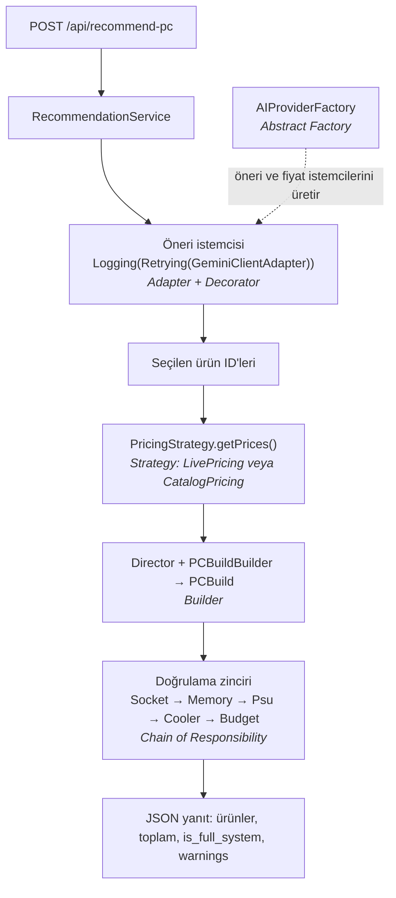
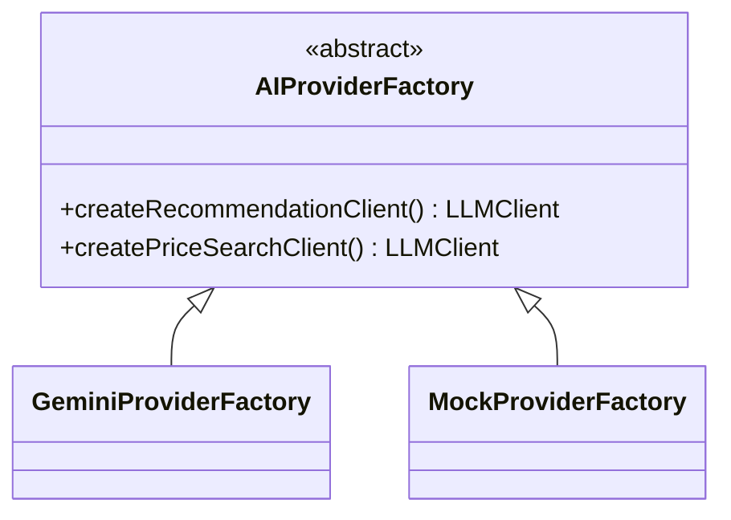
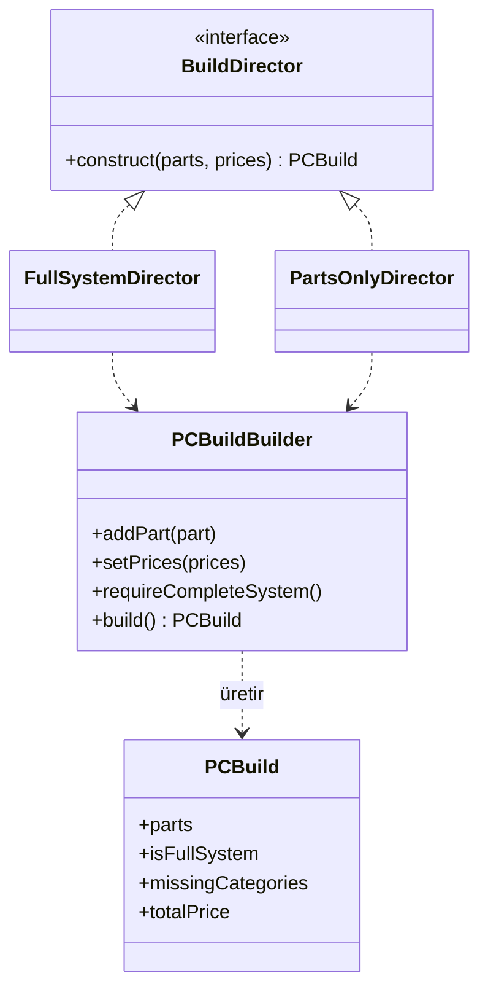
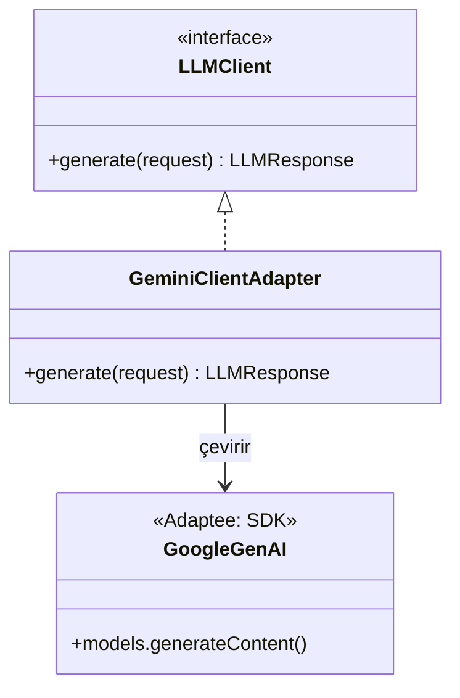
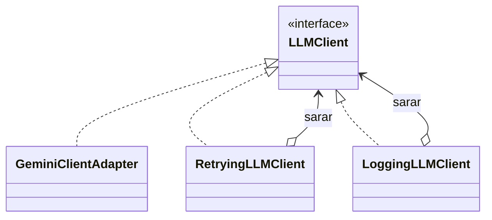
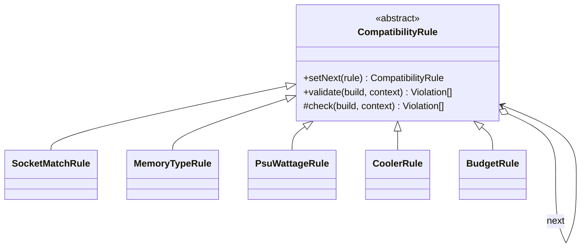
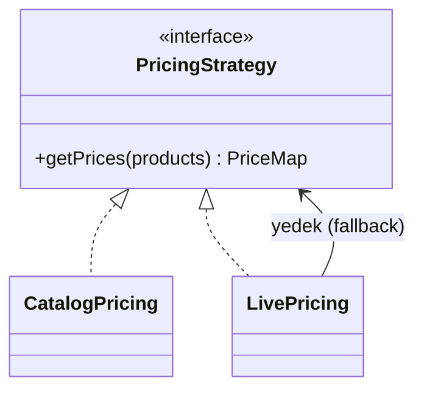

# Tasarım Kalıpları

AI-PC Builder'da altı GoF kalıbı kullanılmıştır (her gruptan iki tane). Bu belge her kalıbın **hangi problemi çözdüğünü**, **hangi sınıflarla uygulandığını** ve **nasıl test edildiğini** gösterir. Kodda her rol, ilgili sınıfın başında `[Kalıp: ...]` yorumuyla işaretlidir.

## Çözülen problemler

Kalıplar uygulanmadan önce kodun büyük kısmı tek bir 390 satırlık `server.ts` içindeydi ve üç sorun vardı:

| Problem | Çözen kalıplar |
|---|---|
| **Model çıktısı doğrulanmıyordu.** Uyumluluk ve bütçe kontrolü yapay zekâya bırakılmıştı; bir testte 30.000 TL bütçeye 43.249 TL'lik, güç kaynağı olmayan bir sistem önerilmişti. | Chain of Responsibility, Builder |
| **Gemini'ye sıkı bağımlılık.** SDK doğrudan çağrılıyordu; model değiştirmek veya kredi harcamadan test yazmak mümkün değildi. | Adapter, Abstract Factory |
| **Kurallar tek rotaya gömülüydü.** Fiyatlama, yeniden deneme ve loglama yaklaşık 100 satırlık tek bir işleyicideydi. | Decorator, Strategy |

## Özet tablo

| Grup | Kalıp | Ana sınıflar | Test dosyası |
|---|---|---|---|
| Yaratımsal | Abstract Factory | [`AIProviderFactory`](src/ai/AIProviderFactory.ts), [`GeminiProviderFactory`](src/ai/GeminiProviderFactory.ts), [`MockProviderFactory`](src/ai/MockProviderFactory.ts) | [`factory.test.ts`](test/factory.test.ts) |
| Yaratımsal | Builder | [`PCBuildBuilder`](src/builder/PCBuildBuilder.ts), [`FullSystemDirector`, `PartsOnlyDirector`](src/builder/directors.ts), [`PCBuild`](src/builder/PCBuild.ts) | [`builder.test.ts`](test/builder.test.ts) |
| Yapısal | Adapter | [`LLMClient`](src/ai/LLMClient.ts), [`GeminiClientAdapter`](src/ai/GeminiClientAdapter.ts) | [`adapter.test.ts`](test/adapter.test.ts) |
| Yapısal | Decorator | [`RetryingLLMClient`](src/ai/RetryingLLMClient.ts), [`LoggingLLMClient`](src/ai/LoggingLLMClient.ts) | [`decorators.test.ts`](test/decorators.test.ts) |
| Davranışsal | Chain of Responsibility | [`CompatibilityRule`](src/validation/CompatibilityRule.ts), `SocketMatchRule`, `MemoryTypeRule`, `PsuWattageRule`, `CoolerRule`, `BudgetRule` ([`src/validation/`](src/validation)) | [`validation.test.ts`](test/validation.test.ts) |
| Davranışsal | Strategy | [`PricingStrategy`](src/pricing/PricingStrategy.ts), [`CatalogPricing`](src/pricing/CatalogPricing.ts), [`LivePricing`](src/pricing/LivePricing.ts) | [`pricing.test.ts`](test/pricing.test.ts) |

Kalıpları birbirine bağlayan sınıf [`RecommendationService`](src/RecommendationService.ts), bağlama işinin yapıldığı yer ise [`composition.ts`](src/composition.ts).

## Bir öneri isteğinin yolu

## 1. Abstract Factory — sağlayıcı ailesi

**Problem:** Öneri istemcisi ve fiyat arama istemcisi birbirine bağlı iki üründür (ikisi de aynı sağlayıcıdan gelmeli) ve gerçek sağlayıcıyı kredi harcamadan değiştirmek gerekir.

**Çözüm:** `AIProviderFactory` iki ürün üretir: `createRecommendationClient()` ve `createPriceSearchClient()`. `GeminiProviderFactory` Gemini ailesini, `MockProviderFactory` sahte aileyi üretir. Hangisinin kullanılacağı tek yerde, `AI_PROVIDER` ortam değişkeniyle seçilir ([`createProviderFromEnv.ts`](src/ai/createProviderFromEnv.ts)).

**Değişime dayanıklılık:** Yeni bir model sağlayıcısı = yeni bir fabrika + yeni bir adaptör. Mevcut kod değişmez.

## 2. Builder — sistemi adım adım kurmak

**Problem:** "Komple sistem" ve "sadece ekran kartı" istekleri farklı kurulur. "Bu bir tam sistem mi?" sorusunu eskiden arayüz Türkçe kategori adlarını eşleştirerek cevaplıyordu.

**Çözüm:** `PCBuildBuilder` parçaları, fiyatları ve "tam sistem kontrolü" adımını sunar. `FullSystemDirector` hepsini sırayla çağırır, `PartsOnlyDirector` kontrol adımını atlar. Sonuç, değişmez bir `PCBuild` nesnesidir; `isFullSystem` ve `missingCategories` buradan gelir. Dahili grafikli işlemcide (`specs.integrated_graphics`) ekran kartı zorunlu sayılmaz.

## 3. Adapter — SDK'yı sistemden saklamak

**Problem:** Gemini SDK'sı doğrudan çağrıldığı için SDK'nın biçimi (`generateContent`, `groundingMetadata`...) tüm koda yayılmıştı.

**Çözüm:** Uygulama yalnızca `LLMClient` arayüzünü bilir. `GeminiClientAdapter` SDK'nın istek ve yanıt biçimini bu arayüze çevirir; JSON yanıt, Google arama aracı ve düşünme seviyesi gibi SDK ayarları yalnızca burada bilinir.

## 4. Decorator — davranışı iç mantığa dokunmadan eklemek

**Problem:** Yeniden deneme ve loglama iş mantığının içine gömülüydü.

**Çözüm:** `RetryingLLMClient` (503'te bekleyip yeniden dener) ve `LoggingLLMClient` (süre ve sonucu loglar) başka bir `LLMClient`'ı sarar ve aynı arayüzü sunar. İstenen sırayla üst üste takılır: `Logging(Retrying(Adapter))`. Kalıtımla `LoggingRetryingClient` gibi sınıflar türetmek gerekmez.

**Değişime dayanıklılık:** Önbellek istenirse `CachingLLMClient` yeni bir dekoratör olarak eklenir, mevcut sınıflara dokunulmaz.

## 5. Chain of Responsibility — doğrulama zinciri

**Problem:** Uyumluluk ve bütçe kontrolü yapay zekâya bırakılmıştı; sunucu hiçbir şeyi denetlemiyordu.

**Çözüm:** Her kural bir zincir halkasıdır ve yalnızca kendi kuralını denetler, bulduğunu rapora ekleyip isteği bir sonrakine devreder. Zincir [`createValidationChain.ts`](src/validation/createValidationChain.ts) içinde kurulur:

| Halka | Denetlediği kural |
|---|---|
| `SocketMatchRule` | İşlemci soketi = anakart soketi |
| `MemoryTypeRule` | Bellek tipi anakart ve işlemciyle uyumlu |
| `PsuWattageRule` | Güç kaynağı ≥ ekran kartının önerilen gücü |
| `CoolerRule` | Soğutucu işlemcinin gücüne uygun |
| `BudgetRule` | Gerçek fiyatlı toplam ≤ kullanıcının bütçesi |

Kullanıcının bütçesini yapay zekâ `budget_tl` alanıyla bildirir (belirtilmediyse `null`, bu durumda bütçe denetlenmez). Bulunan ihlaller yanıtta `warnings` olarak döner ve arayüzde "⚠️ Dikkat" mesajı olarak gösterilir.

**Değişime dayanıklılık:** Yeni bir kural = yeni bir sınıf + `createValidationChain` içine bir satır. [`validation.test.ts`](test/validation.test.ts) bunu gösteren bir test içerir.

## 6. Strategy — fiyat kaynağı

**Problem:** "Bir ürünün bugünkü fiyatı nedir?" sorusunun cevabı tek bir yerde sabitlenmişti.

**Çözüm:** `PricingStrategy` arayüzünün iki gerçekleştirmesi vardır: `CatalogPricing` (kataloğa yazılı fiyat, ücretsiz) ve `LivePricing` (Google aramasıyla doğrulanmış fiyat; kaynak arama sonucu olmalı, katalog fiyatının en az yarısı olmalı, 24 saat önbellek, bulunamazsa katalog fiyatına düşer). Seçim çalışma zamanında `PRICING_MODE` ortam değişkeniyle yapılır ([`composition.ts`](src/composition.ts)).

**Değişime dayanıklılık:** Kampanya fiyatı gibi yeni bir kaynak = yeni bir strateji sınıfı.

## Sınırlar

- Doğrulama zinciri ihlalleri **uyarı olarak bildirir**; sistemi otomatik düzeltmez veya yapay zekâya geri bildirimle yeniden sordurmaz. Bu, sonraki adım olarak düşünülmüştür.
- Gerçek sağlayıcı yalnızca Gemini'dir; ikinci bir sağlayıcı (ör. başka bir model) eklenmemiştir. Mimari bunu bir fabrika ve bir adaptörle mümkün kılar.
- Bütçe, yapay zekânın `budget_tl` alanına güvenir; model bütçeyi yanlış okursa `BudgetRule` yanlış karşılaştırma yapar.
